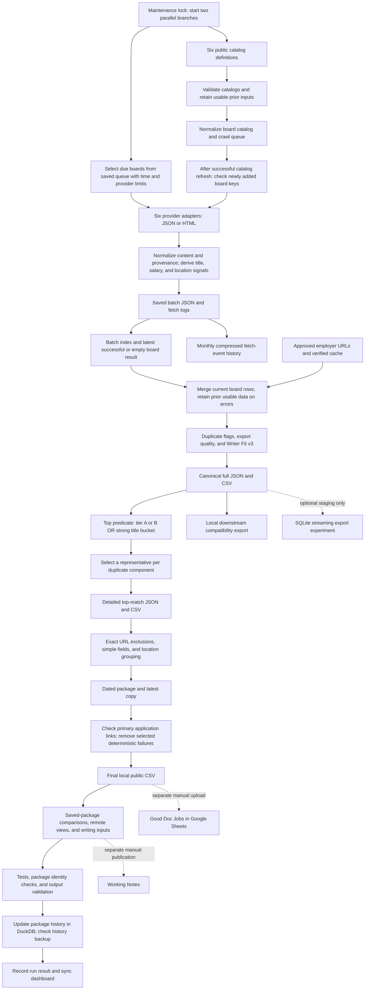

# How the feed actually works

Status: research summary of the local implementation on 2026-10-22. A code path is not proof of a new successful run. Saved results are identified separately.

An ATS is an applicant tracking system. An adapter is code that reads one provider's format. A normalized record uses the same field names as records from other providers. A slice is a filtered view of the full feed.

## Current pipeline

This diagram follows the normal local launcher. Catalog refresh and due-board maintenance start in parallel. A separate added-board pass follows a successful catalog refresh when new keys exist. Catalog failure skips that pass and retains the last usable queue. The downstream compatibility export occurs before package link cleanup. History is an end-of-run side branch built from saved packages. DuckDB is not the source that supplies the current full feed. The SQLite streaming path is not the default publisher. [C01](11-evidence-index.md#c01), [C05](11-evidence-index.md#c05), [C25](11-evidence-index.md#c25), [C27](11-evidence-index.md#c27)

## 1. Discover board candidates

- **Purpose:** find public employer boards to check.
- **Inputs:** six catalog source definitions; imported catalog arrays; existing catalog metadata.
- **Processing:** download and validate catalogs in parallel with due-board maintenance; normalize string or object entries; create company candidates and ATS plus slug board keys; compare the prior and new queue. A successful refresh with additions triggers a bounded added-board pass.
- **Outputs:** normalized catalog, crawl queue, board catalog, and catalog-difference reports under `data/catalogs/`.
- **Sources:** `src/config/catalog-sources.js`; `catalog-refresh.js:parseCatalogText`, `fetchCatalog`; `normalize-catalog.js`; `build-crawl-queue.js`.
- **Edges and failures:** an invalid or empty catalog is rejected. A large count drop needs review. A cached usable catalog can remain the input after failure. A catalog key can be wrong even if its syntax is valid.
- **Dependency and limit:** source discovery uses a public external catalog project. It is not an exhaustive discovery of all employers or a private ATS connection. [C02](11-evidence-index.md#c02)

## 2. Select and collect board results

- **Purpose:** check due boards without checking every source on each pass.
- **Inputs:** crawl queue, board maintenance state, time budget, per-provider limits, and prior success/failure data.
- **Processing:** `board-state.js` uses shorter intervals for boards with good matches, longer intervals for other successful or empty boards, and increasing delay for repeated failures. The due pass can use the saved queue while catalog refresh runs. The added-board pass follows catalog success. `fetch-batch-jobs.js` routes each selected board to its provider adapter.
- **Outputs:** fetched jobs, status, HTTP result, fetch time, and diagnostic evidence.
- **Sources:** `refresh-job-index.js`; `maintain-board-index.js`; `board-state.js:getIntervalHours`, `selectBoards`; `src/lib/ats/*.js`.
- **Edges and failures:** Workday, BambooHR, and iCIMS are marked best-effort in the batch script. Workday stops at a configured maximum of 2,000 jobs; iCIMS stops after at most 20 pages or no growth. These are code limits as inspected, not measured losses. Provider layout changes and access blocks can prevent collection.
- **Dependency and limit:** an attempted board is not a usable board snapshot. A successful request also does not prove complete coverage. TalentBrew probing is separate. [C03](11-evidence-index.md#c03), [C06](11-evidence-index.md#c06)

## 3. Extract and standardize job fields

- **Purpose:** make records from different providers usable together.
- **Inputs:** provider job objects or parsed HTML cards, board context, and the operational title watchlist.
- **Processing:** provider normalizers map titles, locations, descriptions, dates, URLs, departments, salary text, and raw IDs. HTML is removed from descriptions with a small text transformation. Provenance includes ATS, slug, board URL, fetch URL, and `FetchedAt`.
- **Outputs:** normalized batch rows, with original source identifiers and derived signals.
- **Sources:** `jobs-normalize.js:normalizeAshbyJob`, `normalizeGreenhouseJob`, `normalizeLeverJob`, `normalizeGenericAtsJob`; provider-specific normalizers.
- **Edges and failures:** a Workday or BambooHR description can fall back to the title. An iCIMS description can be a card snippet. An empty normalized value means the pipeline did not obtain a usable value; it does not prove the employer published none. Relative Workday paths are joined to a board URL.
- **Dependency and limit:** the shared row is not a raw HTTP-response archive. Raw field names preserve selected source values, not the entire provider payload. [C04](11-evidence-index.md#c04), [C15](11-evidence-index.md#c15)

## 4. Classify title, geography, and salary

- **Purpose:** add useful filters and review signals.
- **Inputs:** title, location, description, salary text, and title watchlist.
- **Processing:** title matching uses exact/contains/token rules and title-review buckets. Work-arrangement rules scan text for remote, hybrid, office, and country signals. Hybrid/office-days signals take priority over remote signals. The eligibility field can be true, false, or `unknown`. Salary detection extracts a range, currency, period, and supporting text.
- **Outputs:** title match/review fields; `RemoteStatus`, confidence and review reason; estimated U.S. remote eligibility; salary fields.
- **Sources:** `title-match.js`; `title-review.js`; `work-arrangement.js:detectWorkArrangement`; `salary-detect.js`.
- **Edges and failures:** “North America” can make the broad U.S.-eligibility signal true. That is weaker than explicit U.S. location evidence. A general mention in a description can mislead a rule. A detected range is not necessarily base salary. Mixed locations can remain uncertain.
- **Dependency and limit:** these values support review. They do not establish state eligibility, work authorization, employer policy, or exact compensation. [C13](11-evidence-index.md#c13), [C14](11-evidence-index.md#c14)

## 5. Save batches and board history

- **Purpose:** retain collection results and select reusable board snapshots.
- **Inputs:** normalized rows and fetch logs.
- **Processing:** write batch JSON and logs; index batches; derive the latest successful or empty result per ATS plus slug; append compact fetch events to monthly gzip JSONL. The local ledger writer deduplicates event IDs and rejects conflicting saved events.
- **Outputs:** `batch-index.json`, `board-latest-fetch.json`, and monthly fetch-event files.
- **Sources:** `fetch-batch-jobs.js`; `index-batches.js`; `batch-history.js:writeDerivedBatchHistory`; `batch-history-ledger.js`.
- **Edges and failures:** a newer failed attempt must not become an empty successful result. Interrupted collection markers and locks support review. The monthly ledger keeps events from retired batch folders. It does not keep every original job payload.
- **Dependency and limit:** current job rows still depend on retained source batches. Monthly event history is a different population from the job-history database. [C07](11-evidence-index.md#c07), [C27](11-evidence-index.md#c27)

## 6. Merge current board records and curated intake

- **Purpose:** form the current broad feed from usable saved board states.
- **Inputs:** indexed batches, derived latest board state, title list, and approved direct-employer submissions.
- **Processing:** the merge prefers derived state when it is usable. Otherwise it rebuilds from logs. For a successful board result, rows come from the selected source batch. A later empty result suppresses older rows. A failed attempt leaves the last usable result available. Approved submissions fetch structured JobPosting data and add normalized rows.
- **Outputs:** merged rows, source/quality summaries, canonical full JSON and CSV.
- **Sources:** `merge-batches.js:updateLatestLiveFetchByBoard`, `keepFreshBoardRow`, `loadDerivedLatestFetchByBoard`; `curated-submissions.js:loadCuratedSubmissionRows`.
- **Edges and failures:** temporary curated-source failures can retain a cached verified row. Curated HTTP 404/410 removes that cached record. Old board rows can remain when refreshes fail. A stale summary or state index can trigger fallback; fallback is not a new employer check.
- **Dependency and limit:** a “current feed” is the current assembled output. It does not mean each row was fetched during this run. Missing from a board snapshot is not a known hiring outcome. [C07](11-evidence-index.md#c07), [C08](11-evidence-index.md#c08)

## 7. Flag duplicates, check quality, and score relevance

- **Purpose:** make a broad collection sortable and explain its problems.
- **Inputs:** merged normalized rows.
- **Processing:** `buildJobExportArtifacts` applies duplicate flags, export validation, then Writer Fit v3. The score includes title bucket, domain signals, role signals, salary evidence, quality, and a possible-duplicate penalty. Non-writer penalties and strong-title exceptions limit misleading high scores. A guardrail caps a high score if strong writing/documentation evidence is absent.
- **Outputs:** full rows with `JobKey`, duplicate keys, quality fields, score, tier, positive/negative signals, and reasons.
- **Sources:** `job-export.js:buildJobExportArtifacts`; `job-dedupe.js`; `export-validation.js`; `writer-fit-score.js:scoreWriterFit`.
- **Edges and failures:** “documentation” can occur in clinical or administrative work. Missing descriptions reduce the available evidence. Remote status is not a term in `scoreWriterFit`, although remote fields can later decide a dedupe tie.
- **Dependency and limit:** this is rule-based review support, not a personal fit prediction or a measured accuracy percentage. The full feed retains low-scoring and flagged records. [C09](11-evidence-index.md#c09), [C11](11-evidence-index.md#c11)

## 8. Select views and one representative per duplicate group

- **Purpose:** prepare a shorter useful set while retaining the broad evidence.
- **Inputs:** canonical full rows and selected slice predicates.
- **Processing:** the top predicate is **tier A or B OR title bucket STRONG_MATCH**. It is not an A/B-only filter. Duplicate selection joins rows through duplicate-group or canonical-URL keys. Fallback keys apply when strong keys are absent. Selection starts with higher Writer Fit score, then tier, quality, remote eligibility, arrangement, salary evidence, provider rank, date, labels, and stable original order.
- **Outputs:** top and deduplicated top JSON/CSV, decision records, and removal summaries.
- **Sources:** `export-public-slices.js:isStrongMatch`, `sortTopRows`; `dedupe-select.js:getDedupeKeys`, `groupRows`, `compareRows`, `selectDedupedRows`.
- **Edges and failures:** transitive grouping can connect more than two rows. Canonical URLs omit query and fragment; identity-bearing query parameters can therefore be lost. Same-company/title/location is evidence of a possible duplicate, not proof of one opening.
- **Dependency and limit:** daily mode does not rebuild every expensive full slice. SQLite staging remains optional and non-publishing. [C10](11-evidence-index.md#c10), [C12](11-evidence-index.md#c12), [C25](11-evidence-index.md#c25)

## 9. Prepare the reader package

- **Purpose:** turn detailed selected rows into a usable spreadsheet table.
- **Inputs:** deduplicated top-match JSON, package timestamp, coverage support files, and exact-URL exclusions.
- **Processing:** exclude reviewed posting URLs; build simple columns; group exact normalized company/title rows when locations differ; select a representative and retain additional application links. A grouped row stays Remote if any member is Remote. Write a dated package and a `latest` copy.
- **Outputs:** `01_good_documentation_jobs.csv`, detailed `03_top_matches_full.csv`, orientation file, dictionary, exclusion audit, and manifest.
- **Sources:** `build-gsheet-package.js:buildSimpleTopFiles`, `groupPublicSheetCountryPostings`; `public-package-eligibility.js:packageEligibility`; `simple-public-export.js`.
- **Edges and failures:** equal titles at one location stay separate. Grouping can combine different openings and mixed arrangements. The simple row does not carry every detailed field. Missing required source files are recorded as package failures/missing files.
- **Dependency and limit:** exact exclusions affect the package, not the raw feed or original scores. The main jobs table does not read all rows directly from the canonical CSV. [C16](11-evidence-index.md#c16), [C17](11-evidence-index.md#c17)

## 10. Check application links and prune selected failures

- **Purpose:** remove known unusable primary links while retaining uncertainty.
- **Inputs:** package primary application URLs.
- **Processing:** inspect HTTP response, final destination, a bounded response sample, and selected provider/page patterns. Safe mode removes 404/410, known closed/error pages, reviewed dead URLs, wrong Greenhouse destinations, and Ashby empty Jobs shells. A 429 rate limit stays. A blocked detail page can remain for review even if the board API lists the job.
- **Outputs:** URL review, failures, summary, a before-prune backup, and a pruned public CSV. The cleanup launcher synchronizes package copies.
- **Sources:** `job-url-health.js:checkJobUrl`, `classifyUrlIssue`; `check-gsheet-url-health.js:isPrunableFailure`, `applyPrune`; `launchers/Clean Broken Links.command`.
- **Edges and failures:** page-pattern rules can miss failures or classify text incorrectly. The main URL column is checked; this is not proof that every secondary application link was tested. `ok: true` for a rate limit means keep the row, not verified access.
- **Dependency and limit:** cleanup occurs after canonical and consumer exports. Those outputs do not inherit package removals. A good check is time-bounded evidence, not a continuing open-job guarantee. [C18](11-evidence-index.md#c18), [C19](11-evidence-index.md#c19)

## 11. Compare packages and write reports

- **Purpose:** show useful list changes and narrower views.
- **Inputs:** final current and previous public CSVs, detailed shortlist rows, and saved package dates.
- **Processing:** compare normalized primary application URLs, with a company/title/location fallback. Compute added, removed, and continuing membership. Remote reports require Remote arrangement plus explicit U.S. or non-U.S. location evidence. Generic “Remote” is insufficient. Multi-region rows can appear in both remote reports. Content metrics distinguish searchable text from missing text.
- **Outputs:** remote reports, daily snapshot, focused views, and Substack Markdown inputs.
- **Sources:** `us-remote-daily-report.js:jobKey`, `compareRows`; `international-remote-daily-report.js`; `report-all-remote-daily.js`; `content-metrics.js`; `substack-full-report.js`.
- **Edges and failures:** changed URLs, grouping, exclusions, source failures, and parsing changes can alter membership. Topic mentions can be employer background text. A missing baseline prevents a valid comparison.
- **Dependency and limit:** “added” means new to the selected list. “Removed” means absent from that list. Neither is an employer posting, closure, or filled-position event. [C14](11-evidence-index.md#c14), [C20](11-evidence-index.md#c20), [C40](11-evidence-index.md#c40)

## 12. Persist package history and observed changes

- **Purpose:** retain evidence across dated packages and support SQL reports.
- **Inputs:** dated public `01` CSVs, detailed `03` CSVs, manifests, and source metadata.
- **Processing:** preserve raw rows; resolve one observation per canonical key; store public inclusion separately; preserve unmatched public rows as exceptions. Format-aware runtime uses the installed v2 schema. It shares repeated text and stores content versions without discarding raw evidence. Lifecycle views derive first observation, absence, return, and selected content/schema changes.
- **Outputs:** DuckDB history, validation, lifecycle query results, and historical report.
- **Sources:** `jobs-history.js:scan`; `job-history-runtime.js:detect`, `runHistory`; `job-history-storage.js:TABLES`; `job-history-bounded-storage.js`; `job-history-lifecycle.js`.
- **Edges and failures:** historical header variants, duplicate raw rows, and unmatched rows remain visible. Structural errors block acceptance. Updates use locks, staging, source checks, and recovery records. The database was not queried here; current format/count claims use saved validation.
- **Dependency and limit:** this is package history, not the full broad-feed history. A reappearance is not proof of an employer repost. Older folder names can lack timezone evidence; recorded UTC times and time-source flags matter. [C21-C24](11-evidence-index.md#c21), [C34](11-evidence-index.md#c34)

## 13. Validate, record status, back up, and publish manually

- **Purpose:** make the local result reviewable and recoverable.
- **Inputs:** current package, reports, test commands, run identity, and history backup policy.
- **Processing:** the launcher makes reports, runs configured tests, validates output identity, updates history, checks backup, records completion, and syncs the dashboard. An outer refresh lock covers this sequence. Backup failure can be a warning after feed checks pass. The passive schedule example performs maintenance only.
- **Outputs:** test summary, output validation, refresh-run receipt, dashboard, history/backup receipt, and files ready for manual review.
- **Sources:** `Refresh Job Feed.command`; `run-test-suite.js:executeTests`; `validate-refresh-output.js`; `daily-history-backup.js`; `com.public-job-feed.maintain-index.plist.example`.
- **Edges and failures:** the test dispatcher checks exit codes. A passing suite can contain warnings in individual report artifacts. A COMPLETE run does not mean every source succeeded. Loaded schedule state and current public Sheet contents remain unverified.
- **Dependency and limit:** Adam uploads the selected CSV to Google Sheets and publishes Working Notes separately. No automatic Google Sheets or Substack publisher is established by this workflow. [C26](11-evidence-index.md#c26), [C27](11-evidence-index.md#c27), [C28](11-evidence-index.md#c28)

## What a job record means

There is no single universal identity key. The broad feed's `JobKey` prefers ATS plus `RawJobId`. Duplicate review also uses a normalized URL and company/title/location. The export selector can join groups through more than one key. Public daily comparisons use the application URL. SQL history uses canonical posting keys from saved detailed rows and separately stores public-export membership.

This matters because provider IDs can be local to a board, query strings can identify a posting, and the reader view can combine several locations. A row is a representation of observed source data, not proof of one unique vacancy. [C09](11-evidence-index.md#c09), [C10](11-evidence-index.md#c10), [C16](11-evidence-index.md#c16), [C22](11-evidence-index.md#c22)

## What the system cannot reliably know

It cannot establish that every employer is covered, every successful board is complete, every role is still open, every remote role accepts a specific applicant, every date is the original posting date, every range is base pay, or every removed record was filled. It does not record applicant outcomes. The presentation should show how the system retains evidence and exposes these limits. [C15](11-evidence-index.md#c15), [C29-C34](11-evidence-index.md#c29), [C41](11-evidence-index.md#c41)
